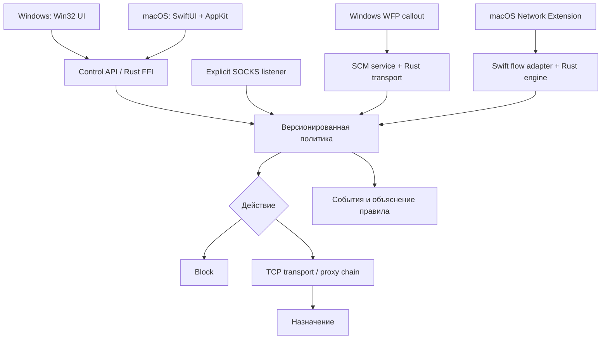

# FlowBridge: архитектура аналога Proxifier

Дата: 28 октября 2026. Рабочее имя: **FlowBridge**. Статус 0.2.0: собранные Windows GUI/CLI/DLL и установщик, общее Rust-ядро с управляемым SSH; исходники интеграции WFP и macOS. Полная прозрачная замена установленного Proxifier ещё требует платформенных сборок и испытаний.

## 1. Цель и исходные данные

Приложение направляет исходящие TCP-соединения выбранных программ через SOCKS/HTTP CONNECT, применяет правила по приложению, назначению и порту, поддерживает цепочки и объясняет принятые решения. Основной пользовательский сценарий — Windows 10/11 и macOS, включая Apple Silicon, с локальным SSH SOCKS5 `127.0.0.1:1080`.

Пользователь предоставил `Proxifier4.rar`; после получения пароля архив прочитан. Статически исследованы installer payload, INF и PE/resources: Proxifier Standard Edition 4.14 x64. Оригинальные executables и вложенный keygen не выполнялись. Инвентаризация и SHA-256: [REFERENCE_REVIEW.md](REFERENCE_REVIEW.md).

Функциональный ориентир — предоставленный экземпляр и публичная документация Proxifier v4 [S1–S4]. Реализация самостоятельная: собственные код, схема конфигурации и нативный UI, без переноса оригинальных бинарников/ресурсов.

## 2. Область первого выпуска и функциональное соответствие

| Возможность | Цель продукта | Состояние 0.2.0 |
|---|---|---|
| SOCKS5 CONNECT, IPv4/IPv6, hostname | Да | Реализовано в Rust |
| SOCKS5 username/password | Да | Реализовано, пароль по имени переменной окружения |
| SOCKS4/SOCKS4a | Совместимость | IPv4 и SOCKS4a hostname реализованы; IPv6 этим протоколом не поддерживается |
| HTTP CONNECT, Basic | Да | Реализовано; транспорт до прокси без TLS |
| TLS до самого прокси | Да, отдельный вид транспорта | Следующая итерация с проверкой сертификата; `http_connect` этого не обещает |
| Цепочки разных протоколов | Да | Последовательное CONNECT на одном туннеле |
| Direct / Block / Proxy / Chain | Да | Реализовано |
| Правила по имени процесса | Да, с подтверждением ОС | Оценка политики реализована; в explicit SOCKS запуск таких правил запрещён |
| Host masks, CIDR, диапазоны портов | Да | Реализовано, первое совпадение выигрывает |
| DNS назначения через прокси | Да | Если приложение передало hostname в SOCKS; перехват DNS ОС ещё не реализован |
| Прозрачный захват Windows | Да | Собственные driver/service sources и pre-connect FFI; user-mode cross-build, kernel build/sign/run ещё требуют Windows |
| Прозрачный захват macOS | Да | Реальный TCP-адаптер и activation manager в исходниках; Xcode/sign/native run ещё не выполнены |
| Нативный UI | Да | Win32: собранный GUI для управления движком; SwiftUI: аналогичное управление в исходниках |
| Управляемый SSH | Да | OpenSSH child, watchdog, keepalive/backoff, readiness, явный Stop |
| Короткий обрыв upstream | Да | Новые local SOCKS соединения ожидают готовности; сохранение уже установленных TCP через новый SSH требует будущего remote relay |
| AI / Web шаблоны и обнаружение | Да | Общий каталог, реальные локальные пути/metadata, редактируемый выбор; системные правила требуют готового native backend |
| Статистика/журнал | Да | Счётчики и состояния, все активные + последние 512 завершённых соединений + 256 событий |
| UDP, QUIC | Отдельная следующая фаза | SOCKS UDP/BIND явно отклоняются; системной блокировки UDP ещё нет |
| Системный kill switch | Опционально после платформенных испытаний | Не реализован; закрытие соединения при ошибке прокси не равно kill switch ОС |
| NTLM/Kerberos, failover, балансировка, импорт PPF | Позже | Не реализовано |

В терминологии разных приложений «HTTPS proxy» может обозначать CONNECT для HTTPS-назначения или TLS-соединение с самим прокси. В конфигурации FlowBridge эти возможности будут названы отдельно. Нынешний `http_connect` не шифрует канал до прокси и не перехватывает TLS приложения.

## 3. Слои системы

Общий код должен владеть правилами, протоколами, жизненным циклом соединения и диагностикой. Адаптер платформы должен получать достоверный процесс и исходное назначение, обеспечивать исключение собственных соединений, передавать поток байтов и применять платформенные гарантии блокировки. UI остаётся непривилегированным. Это предотвращает расхождение правил между Windows и Mac и уменьшает объём опасного кода рядом с ядром ОС.

В 0.2.0 проверенный исполняемый путь — explicit SOCKS с CLI/Win32 управлением. Его наличие позволяет проверять настоящий транспорт до готовности драйвера, но не охватывает программы, не умеющие пользоваться SOCKS. В готовом продукте большинство приложений не потребуют настройки прокси.

### Состав репозитория

| Каталог | Ответственность |
|---|---|
| `crates/flowbridge-core` | JSON-модель, валидация, правила, выбор и развёртка маршрута |
| `crates/flowbridge-net` | Протоколы, аутентификация, цепочки, ограниченный relay |
| `crates/flowbridge-cli` | validate / explain / check / serve / capabilities |
| `crates/flowbridge-runtime` | Жизненный цикл, atomic reload, listener, live status и bounded history |
| `crates/flowbridge-tunnel` | Управление OpenSSH, проверка SOCKS readiness, перезапуски и ограниченные события |
| `crates/flowbridge-ffi` | Owned JSON, registry engine/stream handles, native TCP/WFP socket подготовка |
| `native/windows` | Нативный Win32 UI; ABI и user-mode helpers WFP |
| `native/macos` | SwiftUI UI, проект приложения и System Extension |
| `tests` | Чёрный ящик: реальный CLI и локальные mock endpoints |
| `docs` | Архитектура, платформенные детали, план, статус проверки |

Rust `unsafe` изолирован в FFI/будущих платформенных обёртках. Сетевое ядро не нуждается в собственном unsafe. Win32 UI написан на C++ и использует Win32 controls; macOS UI — SwiftUI/AppKit. Эти компоненты компилируются в нативные приложения. Веб-движок, Electron и веб-UI не требуются.

## 4. Windows: WFP и служба

Целевые конфигурации: Windows 10 22H2 x64 и Windows 11 x64; ARM64 — после отдельных сборок и тестов. Поддержка Windows 10 — решение проекта, а не обещание текущего жизненного цикла поддержки Microsoft.

Для захвата новых исходящих TCP-соединений используется Windows Filtering Platform с ALE connect redirect. Документация Microsoft определяет оригинальное соединение и проксирующий socket как связанные посредством redirect records [S5]. Слой перехвата получает приложение/PID и назначение; локальная служба получает перенаправленное соединение и создаёт исходящее.

Минимальный kernel callout на C выполняет только ограниченные операции: проверяет правило захвата/исключения, сохраняет оригинальный sockaddr и идентификаторы в версионированном контексте, меняет remote endpoint на локальный listener и выставляет redirect handle / target PID. JSON, DNS, аутентификация прокси, UI и сложная логика в драйвер не попадают. Использование экспериментального Rust в kernel не является условием продукта: Rust применяется там, где он снижает риск без усложнения подписывания и WDK-поддержки.

Служба получает `SIO_QUERY_WFP_CONNECTION_REDIRECT_CONTEXT` и `SIO_QUERY_WFP_CONNECTION_REDIRECT_RECORDS` на принятом socket. Opaque records передаются через `SIO_SET_WFP_CONNECTION_REDIRECT_RECORDS` на исходящий socket **до connect**. В 0.2 добавлен `connect_route_prepared`: создаёт отдельный TcpSocket для каждой попытки, вызывает preparation hook до connect, а при ошибке подготовки не подключается без records. C ABI `fb_stream_open_wfp_json` принимает bounded opaque records. Тесты доказывают порядок подготовки и отсутствие незащищённых повторов; реальный IOCTL требует WFP native tests.

### Идентичность и петли

PID сам по себе переиспользуется ОС. Будущая идентичность соединения содержит PID, время запуска процесса, полученный от ОС путь/идентификатор приложения и при необходимости SID/сеанс. Process-name mask в первом ядре — критерий на переданную строку, не доказательство личности программы. Исключения для службы FlowBridge, локального `ssh.exe` и маршрута к upstream должны быть подготовлены до включения захвата. Сам драйвер проверяет redirect state и собственный handle; только исключения по текстовому имени недостаточны [S5].

WFP-фильтры устанавливаются транзакционно, с ограниченной областью provider/sublayer, и удаляются при откате. Нельзя удалять чужие фильтры. Сначала стартуют listener и валидированная политика, затем активируются правила захвата. Для остановки применяется обратная последовательность, с явно выбранным режимом защиты/восстановления. Fail-closed на уровне ОС требует собственной схемы фильтрации и испытания падения службы; нынешнее ядро даёт только отсутствие direct fallback внутри принятого потока.

Исходники службы используют SCM и ограниченный пул перекачки TCP; user-mode часть собрана кросс-компилятором. Продуктовая интеграция UI со службой через именованный канал с ACL, recovery actions и управление системными политиками ещё требуют завершения. Установщик драйвера, подпись, удаление, откат, Driver Verifier, coexistence с VPN/EDR — отдельные критерии готовности. Их нельзя заменить успешным `cargo test`.

## 5. macOS: Network Extension

Цель первой продуктовой версии — macOS 13+ на arm64; Intel x86_64 поддерживается отдельной проверкой и затем universal build. Нативное приложение использует SwiftUI с AppKit для меню и системных диалогов. Прозрачный захват строится на `NETransparentProxyProvider` в System Extension. Нужны корректные signing identities, provisioning/entitlements и подтверждение установки пользователем, регулируемое macOS [S6–S8].

Swift adapter в исходниках принимает `NEAppProxyTCPFlow`, извлекает endpoint и метаданные источника, передаёт их в Rust policy и организует асинхронную перекачку. Реализован потоковый FFI open/read/write/half-close/close, один reader и writer на поток, буферы 64 KiB, backpressure, partial I/O, отмена и idle deadline. Проверенные registry handles заменяют передачу Rust pointers. На Windows FFI использует nonblocking sockets с ограниченным ожиданием WSAPoll; на Unix — ограниченное socket I/O. Реальное выполнение этого Swift-адаптера остаётся задачей сборки с Apple SDK.

Возврат `false` из обработчика transparent proxy означает, что соединение продолжится напрямую [S6]. Реализация Direct использует эту семантику; Block принимает и закрывает поток, Proxy/Chain используют FFI transport. Activation manager проверяет встроенную extension, signing/team/entitlements и ответ готовности provider. Состояние Active не выставляется только по факту запроса активации. Каждая сессия provider имеет UUID: применение правил проверяет его до validation и commit, а UI отбрасывает устаревшие callbacks. TCP capture ограничен выбранными портами (по умолчанию 80/443); DNS/UDP не охватываются.

Не следует строить основной вариант на DYLD injection, глобальных hooks или packet-tunnel без доказательства необходимости. Transparent Proxy соответствует обработке потоков и приложениям; packet tunnel потребует дополнительной маршрутизации, восстановления транспорта и доказательства привязки пакета к процессу. Окончательная проверка доступности и поведения NE обязательна на физических Mac и в подписанной сборке.

## 6. DNS и семантика правил

### Реализовано сейчас

Клиент передаёт в SOCKS5 hostname или IP. Для маршрута через прокси ядро передаёт hostname в SOCKS5/SOCKS4a/CONNECT без локального DNS назначения. Локально может разрешаться адрес **первого** proxy hop; последующие hops разрешаются через предыдущий. Для Direct используется системный resolver. Если клиент уже разрешил имя и передал IP, исходный DNS-запрос ядру неизвестен.

Правила не выполняют DNS, PTR-запросы и догадки по TLS SNI. Если для имени не передан подтверждённый IP, CIDR-критерий не совпадёт. Это предсказуемая семантика, которую покажет будущий Explain UI. Одновременно заполненные `hosts` и `networks` образуют AND; для «домен ИЛИ сеть» создаются два правила.

### Что понадобится для прозрачного режима

На Windows WFP connect redirect обычно видит уже разрешённый адрес; домен нельзя восстановить достоверно по одному IP. Нужен отдельный DNS capture/correlation механизм с TTL, процессной областью, поколениями и обработкой нескольких имён на один IP. Опциональная synthetic-IP схема допустима только после тестов системной совместимости, IPv6, TTL/reuse, bypass и rollback. Перенос «fake IP» подхода Proxifier [S3] буквально не является архитектурным контрактом нового продукта.

На macOS `NETransparentProxyProvider` игнорирует `NEDNSSettings`/`NEProxySettings` в transparent settings, а connect-by-name не обходит обычное разрешение DNS [S6]. Установка одного такого поля не обеспечит DNS через прокси. Полноценный DNS режим требует отдельно подтверждённой интеграции, возможного DNS proxy provider и capture rules. На обеих платформах DoH/DoT, собственные резолверы приложения и cached IP требуют явного документирования границ. До прохождения packet-capture тестов UI не будет обещать «DNS leak protection».

### Правила

Правила проверяются сверху вниз. Первое совпавшее enabled правило определяет Direct, Block, Proxy(id) или Chain(id); иначе используется обязательное действие по умолчанию. Внутри списка действует OR, между критериями — AND. Пустой список означает any. Hostnames принимаются в ASCII/punycode, нормализуется завершающая точка DNS; маски `*` и `?` сопоставляют всю строку. Application masks в текущей схеме ASCII case-insensitive и сопоставляют всю переданную строку; автоматического извлечения basename нет. Для разных OS identities в продукте появятся отдельные типы критериев.

Конфигурация строго версионирована. Неизвестные поля, отсутствующие ссылки, повторяющиеся ID, пустые цепочки, invalid host/port, control characters и неоднозначные числовые IP отклоняются. В 0.2 общий runtime валидирует новый snapshot и атомарно заменяет его; действующие соединения закреплены за старой revision. Ошибочная конфигурация сохраняет предыдущую. Listener/max_connections меняются только в stopped-состоянии. macOS provider поддерживает live-применение только rules/default_action с проверкой текущей session_id; остальные параметры требуют перезапуска. Windows capture service пока загружает профиль при старте.

## 7. Жизненный цикл транспорта

1. Адаптер принимает поток и его origin metadata; в explicit SOCKS metadata приложения отсутствует.
2. Проверяются ограничения: размер handshake, время, разрешённый локальный ingress, квота соединений и защита от простого самоподключения.
3. Policy snapshot выбирает действие и сохраняет rule ID.
4. Block завершает попытку; Direct открывает прямое TCP-соединение; Proxy/Chain выполняет только заданный маршрут.
5. Для цепочки проверяются credentials всех hops, подключается первый hop и последовательно выполняется CONNECT к следующему.
6. Только после успеха upstream клиент получает SOCKS success. Ошибка даёт отказ; fallback к Direct не производится.
7. Relay поддерживает backpressure, EOF/half-close, счётчики байтов и idle deadline, сбрасываемый активностью в любом направлении.
8. Завершение освобождает buffers и permits, а итоговая запись попадает в ограниченную историю. CLI и GUI используют один Engine: Stop прекращает приём, отменяет активные операции и ограниченно ждёт освобождения worker.

Раздельные connect/handshake/idle deadlines дают диагностируемые ошибки. Idle timeout измеряет отсутствие прогресса, а не общий срок жизни соединения. FFI close удаляет handle и будит socket I/O; выполняющиеся операции удерживают Arc, повторный close безопасен. Ошибка live reload сохраняет прежний профиль.

CLI использует `connect_route_guarded`: фактический первый TCP hop разрешается один раз, весь набор IP проверяется на loopback/mapped-loopback с портом listener, после чего используются те же проверенные адреса. Это закрывает самоподключение через DNS alias и исключает повторный lookup между проверкой и connect. Имена следующих hops и конечного назначения остаются на удалённой стороне; их `localhost` не равнозначен локальному listener.

### Управляемый SSH и ожидание восстановления

UI управляет OpenSSH через `flowbridge-tunnel`, без shell и отдельного терминала. Передаются только типизированные параметры; auth — ключ/agent, host key проверяется строго. Watchdog проверяет процесс и SOCKS greeting, использует ограниченный backoff и прекращает перезапуски по Stop. На Windows Job Object завершает принадлежащие приложению дочерние процессы при закрытии; на Unix/macOS аварийная смерть родителя пока не имеет такой гарантии.

Engine продолжает слушать локальный порт при reconnect. Новые соединения к управляемому upstream ожидают готовности до 30 секунд по настройке UI (API допускает до 120); другие маршруты не задерживаются. Уже существующие TCP нельзя прозрачно перенести в новую SSH-сессию. Для этого спроектирован независимый server relay с идентификаторами потоков, offsets/ACK, дедупликацией и ограниченными буферами; он ещё не реализован. Подробности и первичные источники: [SSH_AND_RECONNECT.md](SSH_AND_RECONNECT.md).

## 8. Секреты, IPC и наблюдаемость

Паролей нет в JSON и командной строке. Для разработки `password_env` хранит имя переменной, её значение считывает транспорт. Это удобный временный источник, а не системное хранилище секретов. Продукт использует macOS Keychain и Windows Credential Manager/DPAPI с областью пользователя; служба получает только разрешённые opaque references. Выбор системного credential backend и миграция ещё не реализованы.

RFC1929 передаёт username/password без защиты канала [S10]. Basic также нуждается в защищённом канале; локальный SSH SOCKS защищает дальнейший путь SSH, но plain CONNECT к внешнему proxy сам по себе TLS не создаёт. TLS до upstream — отдельная функция с hostname verification, системными trust roots и без опции «отключить проверку по умолчанию».

CLI listener привязан к loopback и не требует аутентификации клиентов. На многопользовательской машине к нему могут обратиться другие локальные процессы; он не является средством изоляции пользователей или firewall. Это граница режима разработки. Продуктовый control plane использует named pipe/XPC с подтверждением peer, правами и ограниченным набором команд; административный HTTP-порт не нужен.

В логах есть destination host/port, rule ID, action, protocol error category и итоговые байты. Ответы прокси, пароли и содержимое трафика не логируются. Hostnames могут быть чувствительными; выпуск предусматривает переключатель детализации, локальную ротацию и редактируемый диагностический экспорт. В 0.2 есть stderr text/JSON и live bounded history в GUI; автоматической ротации и persist store соединений пока нет.

Снимок политики, коннекторы и FFI создают явные границы тестирования. Обработчик FFI возвращает выделенную Rust строку JSON, которую освобождает `fb_string_free`; native caller обязан передать корректные NUL-terminated строки. C ABI не должен принимать pointer/JSON от недоверенного внешнего процесса напрямую. Panic перехватывается на этой границе, но неверный foreign pointer остаётся ошибкой вызывающего кода.

## 9. Решения, отложенные до доказательства необходимости

- Proxy failover: только явно настроенные альтернативы, с разными состояниями «соединение не начато» и «байты уже переданы». Автоматический replay прикладного потока запрещён.
- UDP/QUIC: отдельная модель datagram association, TTL, MTU, timeouts и fallback. Пока UDP не реализован, невозможно обещать охват «всего трафика».
- TUN backend: возможен для дополнительных сценариев, но не заменяет выбранные per-application API без анализа идентичности и DNS.
- SSH: менеджер OpenSSH уже реализован. Первый trust wizard, password/системное хранилище секретов и сохранение TCP через remote relay остаются следующими этапами.
- PPF import: парсер публично описанной XML-структуры с preview, отключёнными external entities, явными unsupported полями и без переноса зашифрованных паролей. Нет предположения, что архив содержит подходящий профиль.
- Updates/телеметрия: до рабочего продукта не добавляются фоновые сетевые обращения. Подписанный update manifest и rollback войдут в выпускную фазу.

## 10. Первичные источники

Проверены 28 октября 2026; ограничения SDK и подписывания перепроверяются перед выпуском. Сведения из документации отделены от собственных проектных решений выше.

- **S1** Proxifier v4, введение и протоколы: https://www.proxifier.com/docs/win-v4/
- **S2** Proxification Rules: https://www.proxifier.com/docs/win-v4/rules.html
- **S3** Name Resolution: https://www.proxifier.com/docs/win-v4/dns.html
- **S4** Proxy Chains: https://www.proxifier.com/docs/win-v4/chain.html
- **S5** Microsoft, Using Bind or Connect Redirection: https://learn.microsoft.com/en-us/windows-hardware/drivers/network/using-bind-or-connect-redirection
- **S6** Apple, NETransparentProxyProvider: https://developer.apple.com/documentation/networkextension/netransparentproxyprovider
- **S7** Apple, Network Extension: https://developer.apple.com/documentation/networkextension
- **S8** Apple, System Extensions: https://developer.apple.com/documentation/systemextensions
- **S9** SOCKS5, RFC1928: https://www.rfc-editor.org/rfc/rfc1928
- **S10** SOCKS5 authentication, RFC1929: https://www.rfc-editor.org/rfc/rfc1929
- **S11** HTTP CONNECT, RFC9110 §9.3.6: https://www.rfc-editor.org/rfc/rfc9110.html#name-connect

Платформенные схемы сборки, ABI, entitlements и release gates подробнее описаны в `PLATFORMS.md`; фактические выполненные проверки — в `VERIFICATION.md`.
